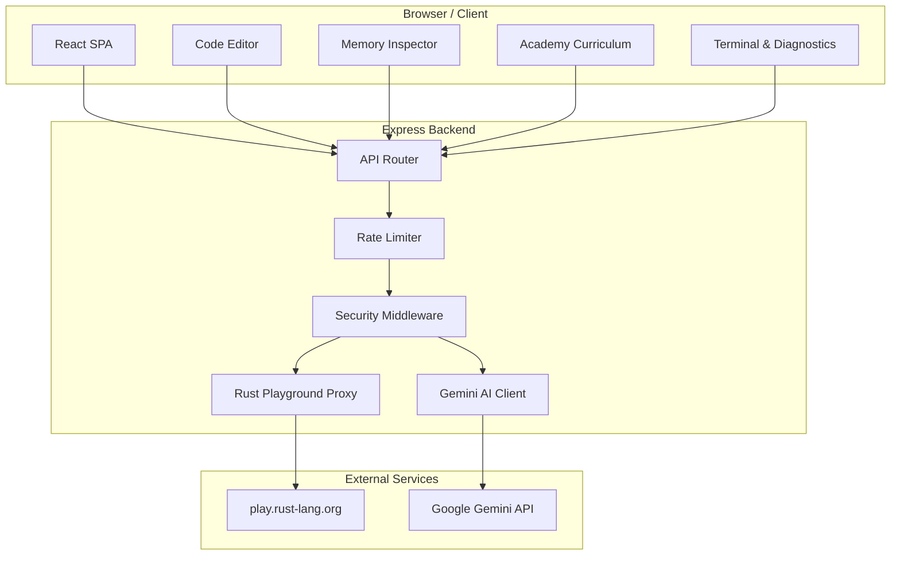
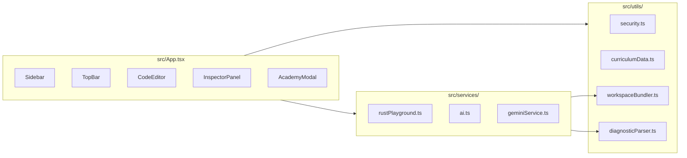
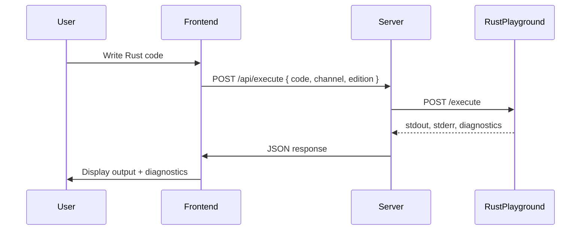

<h1 align="center">FerricForge — Terminal-Grade Rust Systems Workbench</h1>

<p align="center">
  A production-ready Rust learning platform with an interactive code editor, live memory inspector, borrow checker visualizer, and guided academy curriculum. Built with React, TypeScript, Vite, and Express.
</p>

<div align="center">
  <a href="#demo">Demo</a> •
  <a href="#features">Features</a> •
  <a href="#architecture">Architecture</a> •
  <a href="#quick-start">Quick Start</a> •
  <a href="#api-reference">API Reference</a> •
  <a href="#security">Security</a> •
  <a href="#license">License</a>
</div>

---

## 🎬 Demo

Watch a walkthrough of the FerricForge workbench in action:

[▶️ Watch Video Walkthrough](Walkaround/Screen%20Recording%202026-11-05%20150248.mp4)

*(34 MB MP4 — click to download or view in browser)*

---

## 🚀 Features

| Feature | Description |
|---------|-------------|
| **Rust Playground** | Compile, run, and test Rust code via the official Rust Playground API proxy |
| **Memory Inspector** | Live stack/heap visualization with borrow checker verification |
| **Systems Academy** | Staged curriculum from programming fundamentals to advanced Rust (generics, traits, lifetimes, concurrency, smart pointers, async) |
| **Instant Feedback** | Real-time diagnostics, Clippy linting, rustfmt formatting, and AI-powered error explanations |
| **Capstone Projects** | Mini-Redis, linked lists, graphs, BST, QuickSort, Trie, and slab allocator projects |
| **Workspace Bundling** | Multi-file Rust workspace support with `mod` declaration management |
| **Secure by Design** | CSP headers, rate limiting, input validation, sanitized outputs, CORS restrictions |

---

## 🏗️ Architecture

FerricForge follows a client-server architecture. The frontend is a React SPA served by Vite in development and as static assets in production. The backend is an Express server that proxies compiler requests to the Rust Playground API and optionally routes AI diagnostic requests to Google Gemini.

### System Diagram



### Component Architecture



### Data Flow



---

## 🛠️ Tech Stack

| Layer | Technology | Version |
|-------|------------|---------|
| Frontend Framework | React | 19.x |
| Language | TypeScript | 5.5.x |
| Build Tool | Vite | 8.x |
| Styling | Tailwind CSS | 4.x |
| Icons | Lucide React | 0.546.x |
| Backend | Express.js | 4.x |
| Compiler API | Rust Playground | public API |
| AI Explanations | Google GenAI | optional |
| Animations | Motion | 12.x |

---

## 📁 Project Structure

```
rust-playground-pro_V2/
├── src/
│   ├── App.tsx                 # Application shell & layout
│   ├── main.tsx                # React entry point
│   ├── index.css               # Tailwind + design system tokens
│   ├── components/
│   │   ├── AcademyModal.tsx    # Interactive lesson curriculum
│   │   ├── CodeEditor.tsx      # Rust code editor with syntax highlighting
│   │   ├── InspectorPanel.tsx  # Terminal, diagnostics, memory, ASM tabs
│   │   ├── Sidebar.tsx         # File explorer + lesson navigation
│   │   └── TopBar.tsx          # Top navigation with run/format/clippy
│   ├── services/
│   │   ├── rustPlayground.ts   # Rust Playground API client
│   │   ├── geminiService.ts    # AI diagnostic explanations (optional)
│   │   └── ai.ts               # GenAI client singleton
│   ├── types/
│   │   └── rust.ts             # TypeScript type definitions
│   └── utils/
│       ├── security.ts         # XSS, path traversal, prototype pollution defenses
│       ├── curriculumData.ts   # Lesson content (Stages 1–4 + DSA)
│       ├── workspaceBundler.ts # Multi-file workspace bundling
│       └── diagnosticParser.ts # rustc diagnostic parsing
├── server.ts                   # Express backend with API routes + CSP
├── vite.config.ts              # Vite configuration
├── tsconfig.json               # TypeScript configuration
├── package.json                # Dependencies & scripts
├── LICENSE                     # MIT License
├── SECURITY.md                 # Security policy & disclosure
├── CONTRIBUTING.md             # Contribution guide
└── README.md                   # This file
```

---

## 🚀 Quick Start

### Prerequisites

- Node.js 18+
- npm or yarn

### Installation

```bash
# Clone the repository
git clone https://github.com/dhanjit97/ferricforge.git
cd rust-playground-pro_V2

# Install dependencies
npm install

# Configure environment (optional, for AI features)
cp .env.example .env.local
# Add your GEMINI_API_KEY to .env.local

# Start development server
npm run dev

# Open http://localhost:3000
```

### Production Build

```bash
npm run build
npm run preview
```

### Available Scripts

| Script | Description |
|--------|-------------|
| `npm run dev` | Start Vite dev server on port 3000 |
| `npm run build` | Production build via Vite |
| `npm run preview` | Preview production build locally |
| `npm run lint` | TypeScript type check (`tsc --noEmit`) |
| `npm run clean` | Remove `dist/` and `server.js` |

---

## 🔌 API Reference

All API endpoints are rate-limited (20 requests/minute per IP per endpoint) and protected by CSP headers.

| Endpoint | Method | Description |
|----------|--------|-------------|
| `POST /api/execute` | Compile and run Rust code |
| `POST /api/compile` | Compile to ASM / LLVM-IR / HIR / MIR / WASM |
| `POST /api/format` | Format code with rustfmt |
| `POST /api/clippy` | Run Clippy lints |
| `POST /api/explain-error` | AI-powered error explanation (requires `GEMINI_API_KEY`) |
| `POST /api/optimize` | AI-powered code optimization (requires `GEMINI_API_KEY`) |
| `POST /api/generate-tests` | AI-generated unit tests (requires `GEMINI_API_KEY`) |
| `POST /api/explain-asm` | AI-powered assembly explanation (requires `GEMINI_API_KEY`) |
| `GET /api/health` | Health check |

### Environment Variables

| Variable | Required | Description |
|----------|----------|-------------|
| `GEMINI_API_KEY` | No | Google Gemini API key for AI features |
| `APP_URL` | No | Application URL for CORS validation |
| `NODE_ENV` | No | `production` or `development` |

Copy `.env.example` to `.env.local` and fill in your values.

---

## 🔒 Security

FerricForge follows defense-in-depth principles:

- **Content Security Policy** — Strict CSP, no `unsafe-inline` in production
- **Rate Limiting** — 20 requests/minute per IP per API endpoint
- **Input Validation** — All code input validated (max 250KB, null byte stripping)
- **Error Sanitization** — Stack traces and internals never leaked to clients
- **CORS** — Restricted to same-origin only
- **No Local Execution** — User code is never executed on the server; proxied to play.rust-lang.org

See [SECURITY.md](SECURITY.md) for the full security policy and vulnerability disclosure process.

---

## 📚 Academy Curriculum

The academy is organized into stages:

| Stage | Title | Topics |
|-------|-------|--------|
| 1 | Programming from Zero | Variables, types, operators, conditions, loops, functions, user input |
| 2 | Understanding Rust | Ownership, borrowing, slices, structs, enums, Option/Result, error handling, strings & collections |
| 3 | Intermediate Rust | Generics, iterators, derive macros, const/static, shadowing, closures, Drop/RAII, where clauses, smart pointers, traits, concurrency, testing, production error handling, modules |
| 4 | Advanced Rust | Smart pointers, graph arena, BST, QuickSort, Trie, linked lists, unsafe Rust, macros, const generics, async/Tokio |

Each lesson includes: overview, technical breakdown, walkthrough code, annotations, hands-on exercise, and knowledge check quiz.

---

## 📄 License

MIT License — see [LICENSE](LICENSE) for details.

---

<div align="center">
  <sub>Built with ❤️ for the Rust community</sub>
</div>
