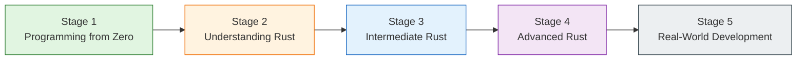
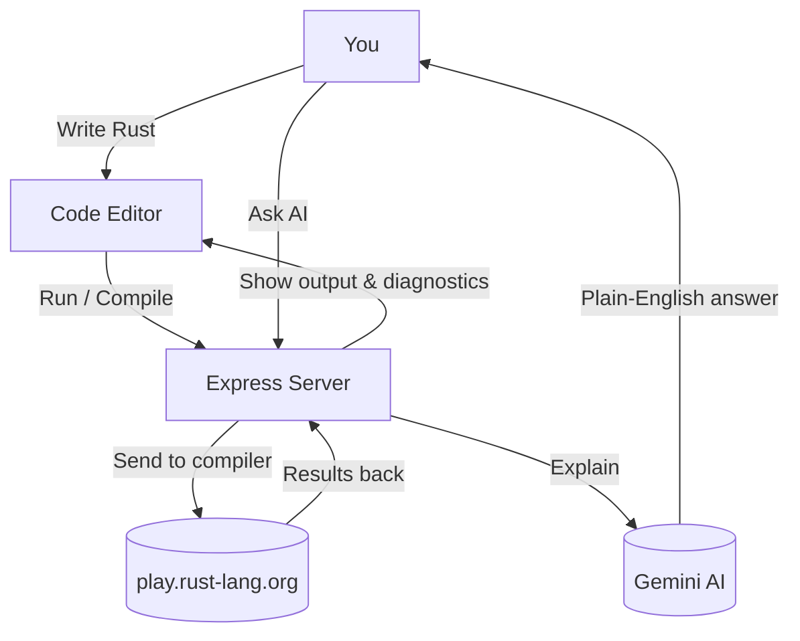

# FerricForge

> An interactive, browser-based Rust learning environment. Write real Rust code, see it compile, and learn everything from "what is programming?" through ownership, borrowing, and beyond — with guided lessons, visual diagnostics, and AI-powered explanations.

[](LICENSE)
[](https://nodejs.org/)
[](https://react.dev/)
[](https://www.typescriptlang.org/)
[](https://vitejs.dev/)

---

## Table of Contents

- [About FerricForge](#about-ferricforge)
- [Key Features](#key-features)
- [Academy Curriculum](#academy-curriculum)
- [Getting Started](#getting-started)
  - [Prerequisites](#prerequisites)
  - [Installation](#installation)
  - [Configuration](#configuration)
  - [Running the Development Server](#running-the-development-server)
  - [Building for Production](#building-for-production)
- [How It Works](#how-it-works)
- [API Reference](#api-reference)
- [Project Structure](#project-structure)
- [Security & Privacy](#security--privacy)
- [Contributing](#contributing)
- [License](#license)
- [Legal Disclaimer](#legal-disclaimer)

---

## About FerricForge

FerricForge is a full-stack learning platform for the Rust programming language. It runs entirely in the browser with a Node.js/Express backend and a React frontend. Users write Rust code in a multi-file workspace, compile and execute it against a remote compiler service (play.rust-lang.org), and receive formatted diagnostics, assembly output, and optional AI-powered explanations.

No Rust toolchain installation is required on the user's machine — everything compiles and runs remotely, and results are streamed back to the browser.

---

## Key Features

| Feature | Description |
|---------|-------------|
| **Code Editor** | Multi-file Rust workspace with syntax highlighting and diagnostics |
| **Run & Compile** | Execute code, or compile to ASM / LLVM-IR / HIR / MIR / WASM / Expand |
| **Diagnostics** | `rustc` errors mapped back to your source lines — click to jump to the fix |
| **Assembly Viewer** | Inspect what the compiler actually generates under the hood |
| **Clippy** | Idiomatic Rust suggestions and lint warnings |
| **AI Assistance** | Plain-English error explanations, code optimizations, and generated tests (optional, requires API key) |
| **Academy** | Guided curriculum: lessons, exercises, knowledge checks, XP, and leveling up |
| **Capstones** | One-click multi-file project workspaces for production-style Rust apps |
| **DSA Lab** | Memory-model visualizations for data structures and algorithms in Rust |

---

## Academy Curriculum

The Academy walks you through Rust step by step:



- **Stage 1** — What is programming? → Your first program → Variables → Data types → Conditions → Loops → Functions → User input
- **Stage 2** — Ownership → Borrowing → Slices → Structs → Enums & Match → `Option`/`Result` → Error handling → Strings & collections
- **Stage 3–5** — Intermediate through real-world development (frameworks, async, production projects)

Each lesson includes a guide, an annotated code walkthrough, a practice challenge, and a knowledge check quiz. Earn XP, level up, and unlock the next lesson as you progress.

---

## Getting Started

### Prerequisites

- **Node.js 18 or later**
- **npm** (comes with Node.js), or yarn/pnpm
- A code editor with TypeScript support (VS Code recommended)

### Installation

```bash
# Clone the repository
git clone https://github.com/YOURUSER/ferricforge.git
cd ferricforge

# Install dependencies
npm install
```

### Configuration

Create a `.env` file from the example template:

```bash
cp .env.example .env
```

Then edit `.env` and fill in your values:

| Variable | What It Does | Required |
|----------|--------------|----------|
| `GEMINI_API_KEY` | Unlocks AI error explanation, optimization, and test generation | Optional |
| `APP_URL` | Your app's public URL (used for self-referential links) | Optional |

> **Tip:** Never commit `.env` to version control. It is already in `.gitignore`. The `.env.example` file contains placeholder values only.

### Running the Development Server

```bash
npm run dev
```

This starts the Express server with Vite middleware on **`http://localhost:3000`**. The server:

- Serves the React SPA with Hot Module Replacement (HMR)
- Proxies API requests to external services (Rust compiler, Gemini AI)
- Enables source maps for debugging

Open `http://localhost:3000` in your browser and start coding.

### Building for Production

```bash
npm run build
```

Outputs a production bundle to `dist/`. The bundle includes minified JavaScript and CSS, an optimized React application, and static assets. Serve `dist/` with any static file host or Node.js server.

---

## How It Works



- Your code **never runs on the app server** — it is sent to a remote compiler service and the results come back to your browser.
- AI features (error explanation, optimization, test generation) are optional and require a `GEMINI_API_KEY`. The key is read **only on the server** and is never exposed to the browser.

---

## API Reference

All routes live under `/api/`. Full details are in [`docs/api-reference.md`](docs/api-reference.md).

| Endpoint | Method | Description |
|----------|--------|-------------|
| `/api/health` | GET | Check if the server is alive |
| `/api/execute` | POST | Compile and run Rust code (or run tests) |
| `/api/compile` | POST | Compile to ASM, LLVM-IR, HIR, MIR, WASM, or expanded macros |
| `/api/format` | POST | Format code with `rustfmt` |
| `/api/clippy` | POST | Run Clippy idiomatic Rust lint checks |
| `/api/explain-error` | POST | AI explains compiler errors (requires `GEMINI_API_KEY`) |
| `/api/optimize` | POST | AI suggests cleaner code (requires `GEMINI_API_KEY`) |
| `/api/generate-tests` | POST | AI writes unit tests for your code (requires `GEMINI_API_KEY`) |
| `/api/explain-asm` | POST | AI explains assembly output (requires `GEMINI_API_KEY`) |

Example execute request:

```http
POST /api/execute
Content-Type: application/json

{
  "channel": "stable",
  "mode": "debug",
  "edition": "2021",
  "crateType": "bin",
  "tests": false,
  "code": "fn main() { println!(\"Hello, FerricForge!\"); }",
  "backtrace": false
}
```

---

## Project Structure

```
ferricforge/
├── README.md               # You are here
├── docs/                   # Deep-dive docs (architecture, API, security, user guide, dev guide, legal)
├── index.html              # Vite entry HTML
├── package.json            # Project manifest & scripts
├── server.ts               # Express server + API proxy
├── tsconfig.json           # TypeScript configuration
├── vite.config.ts          # Vite build configuration
├── .env.example            # Copy this to .env and fill in your values
├── .gitignore              # Git ignore rules
├── dist/                   # Production build output (gitignored)
├── node_modules/           # Dependencies (gitignored)
└── src/                    # React application
    ├── App.tsx             # Root application component
    ├── main.tsx            # Application entry point
    ├── index.css           # Global styles
    ├── components/         # UI components (editor, modals, viewers, etc.)
    ├── types/              # TypeScript type definitions
    └── utils/              # Utility modules (highlighting, parsing, data)
```

---

## Security & Privacy

We take security seriously so you can focus on learning:

- **Your code doesn't run here** — It is sent to an external compiler service, not executed on our server.
- **No secrets stored** — API keys and credentials stay on the server, never in your browser.
- **Rate limiting** — Endpoints are throttled so no single user can overload the system.
- **Security headers** — Modern browser protections (CSP, frame options, etc.) are enabled.

**⚠️ Please don't paste secrets into the editor.** Since your code is sent to external services for compilation and (optionally) AI explanation, avoid entering API keys, passwords, private keys, or confidential company code. Think of it like a public notebook — great for learning, not for secrets.

---

## Contributing

We'd love your help! To contribute:

1. Fork the repository
2. Create a feature branch (`git checkout -b feature/your-feature`)
3. Make your changes
4. Commit your changes (`git commit -m "feat: describe your change"`)
5. Push to the branch (`git push origin feature/your-feature`)
6. Open a pull request

Bug reports and feature ideas are welcome too — open an issue and let us know.

---

## License

MIT License — free to use, modify, and share. See [`LICENSE`](LICENSE) for details.

---

## Legal Disclaimer

**This app is for learning and demonstration.** It is provided "as is" without guarantees. While we've built it with care, we can't promise it's perfect, secure forever, or that external services will always be available.

You are responsible for the code you write and run here — don't submit secrets, and follow applicable laws. The full legal details are in [`docs/LEGAL_DISCLAIMER.md`](docs/LEGAL_DISCLAIMER.md).

---

**Happy learning, and welcome to the Rustacean community!** 🦀