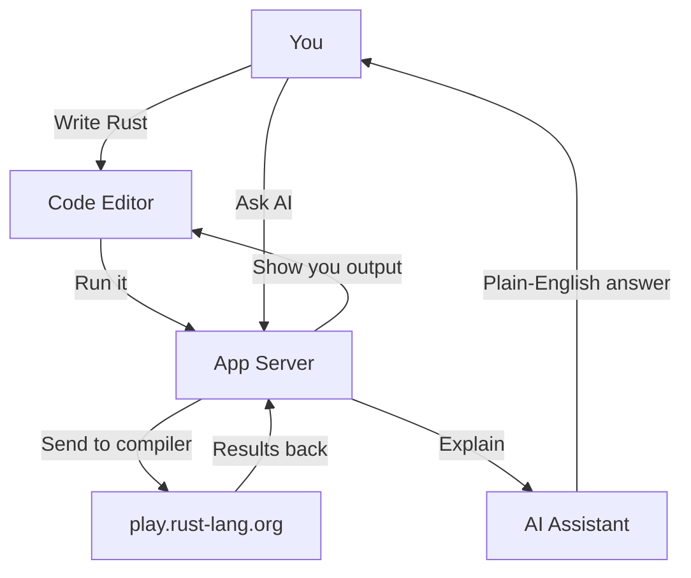
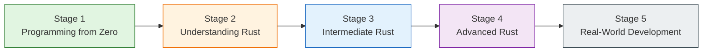

# FerricForge

Welcome to FerrisForge Academy! 🦀

An interactive, browser-based Rust learning environment where you can write real Rust code, see it compile, and learn everything from "what is programming?" through ownership, borrowing, and beyond — all with guided lessons, visual diagnostics, and AI-powered explanations.

---

## What You Can Do

| Feature | What It Does |
|---------|--------------|
| **Code Editor** | Multi-file Rust workspace with syntax highlighting and diagnostics |
| **Run & Compile** | Execute code, or compile to ASM / LLVM-IR / HIR / MIR / WASM / Expand |
| **Diagnostics** | See rustc errors mapped back to your source lines — click to jump to the fix |
| **Assembly Viewer** | Peek under the hood at what the compiler actually generates |
| **Clippy** | Get idiomatic Rust suggestions and lint warnings |
| **AI Assistance** | Get plain-English error explanations, code optimizations, and generated tests (optional) |
| **Academy** | Guided curriculum: lessons, exercises, knowledge checks, XP, and leveling up |
| **Curriculum** | Stage 1: Programming from Zero → Stage 2: Understanding Rust (ownership, borrowing, slices, structs, enums, Option/Result, error handling, strings & collections) |
| **Frameworks** | Under-the-hood guides for Axum, Tokio, Bevy, Ratatui, Tauri, and CLI |
| **Capstones** | One-click multi-file project workspaces for production-style Rust apps |
| **DSA Lab** | Memory-model visualizations for data structures and algorithms in Rust |

---

## Getting Started

### Install

```bash
cd rust-playground-pro
npm install
```

### Configure

Create a `.env` file from the example:

```bash
cp .env.example .env
```

| Variable | What It Does | Needed? |
|----------|--------------|---------|
| `GEMINI_API_KEY` | Unlocks AI error explanation, optimization, and test generation | Optional |
| `APP_URL` | Your app's public URL | Optional |

> **Tip:** Never commit `.env` to version control — `.env.example` has placeholder values only.

### Run It

```bash
npm run dev
```

Open `http://localhost:3000` and start coding!

### Build for Production

```bash
npm run build
```

The output goes to `dist/` — serve it with any static host or Node.js server.

---

## How It Works (Simply)



Your code never runs on the app server — it's sent to a remote compiler service, and the results come back to your browser.

---

## Learn With the Academy

The Academy walks you through Rust step by step:



- **Stage 1** — What is programming? → Your first program → Variables → Data types → Conditions → Loops → Functions → User input
- **Stage 2** — Ownership → Borrowing → Slices → Structs → Enums & Match → Option/Result → Error handling → Strings & collections

Each lesson has a guide, an annotated code walkthrough, a practice challenge, and a knowledge check quiz. Earn XP, level up, and unlock the next lesson as you go.

---

## Security & Privacy (The Friendly Version)

We take security seriously so you can focus on learning:

- **Your code doesn't run here** — It's sent to an external compiler service, not executed on our server.
- **No secrets stored** — API keys and credentials stay on the server, never in your browser.
- **Rate limiting** — Endpoints are throttled so no single user can overload the system.
- **Security headers** — Modern browser protections (CSP, frame options, etc.) are enabled.

**⚠️ Please don't paste secrets into the editor.** Since your code is sent to external services for compilation and (optionally) AI explanation, avoid entering API keys, passwords, private keys, or confidential company code. Think of it like a public notebook — great for learning, not for secrets.

---

## Quick API Look

All routes live under `/api/`:

| Endpoint | What It Does |
|----------|--------------|
| `GET /api/health` | Is the server alive? |
| `POST /api/execute` | Run or test your Rust code |
| `POST /api/compile` | Compile to ASM, IR, WASM, etc. |
| `POST /api/format` | Prettify with rustfmt |
| `POST /api/clippy` | Idiomatic Rust lint checks |
| `POST /api/explain-error` | AI explains compiler errors (needs API key) |
| `POST /api/optimize` | AI suggests cleaner code (needs API key) |
| `POST /api/generate-tests` | AI writes unit tests for you (needs API key) |
| `POST /api/explain-asm` | AI explains assembly output (needs API key) |

---

## Project Structure

```
rust-playground-pro/
├── README.md          # You are here
├── docs/              # Deep-dive docs (architecture, API, security, user guide, dev guide, legal)
├── index.html
├── package.json
├── server.ts          # Express server + API proxy
├── tsconfig.json
├── vite.config.ts
├── .env.example       # Copy this to .env and fill in your values
├── .gitignore
├── dist/              # Production build (gitignored)
├── node_modules/      # Dependencies (gitignored)
└── src/               # React app
    ├── App.tsx
    ├── components/
    ├── types/
    └── utils/
```

---

## Contributing

We'd love your help! Fork the repo, make your changes, and open a pull request. Bug reports and feature ideas are welcome too.

---

## License

MIT License — free to use, modify, and share.

---

## Legal Stuff (Keep It Simple)

**This app is for learning and demonstration.** It's provided "as is" without guarantees. While we've built it with care, we can't promise it's perfect, secure forever, or that external services will always be available.

You're responsible for the code you write and run here — don't submit secrets, and follow applicable laws. The full legal details are in `docs/LEGAL_DISCLAIMER.md` if you want to read them.

---

**Happy learning, and welcome to the Rustacean community!** 🦀