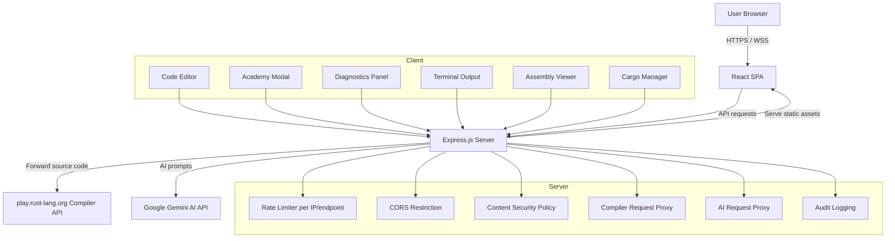
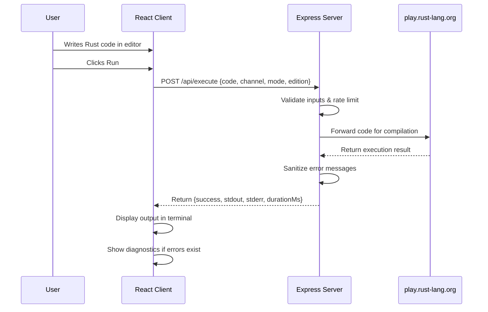
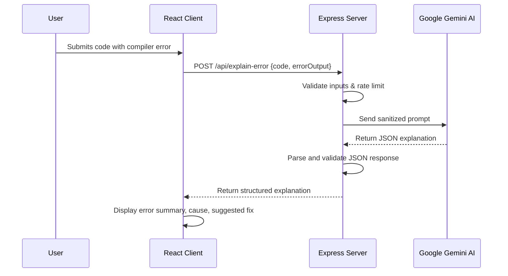

# Architecture Overview

This document describes the system architecture of FerrisForge Academy — Rust Playground Pro.

## High-Level Design

The application follows a client-server architecture where the client is a React single-page application and the server is an Express.js API that proxies requests to external services.

## Client Components

### Code Editor
- Multi-file workspace management (main.rs, Cargo.toml, additional modules)
- Syntax highlighting and diagnostics display
- File creation, deletion, and module declaration toggling

### Academy Modal
- Curriculum browser with lesson gating (sequential unlocking)
- Guide / Walkthrough / Exercise / Knowledge Check tabs
- Progressive hint system with unlock mechanics
- Knowledge check scoring and XP rewards

### Diagnostics Panel
- Parses rustc stderr output
- Maps diagnostic line numbers back to workspace files
- Click-to-navigate to error location in editor

### Terminal Output
- Displays program stdout/stderr
- Shows execution duration and success/failure status

### Assembly Viewer
- Displays generated assembly, LLVM-IR, HIR, MIR, or WASM output
- Refresh capability for recompilation

## Server Responsibilities

The Express server acts as a secure proxy layer:

1. **Rate Limiting** — Per-IP, per-endpoint request throttling to prevent abuse.
2. **CORS Enforcement** — Restricts cross-origin access to the application's origin.
3. **Security Headers** — CSP, X-Content-Type-Options, X-Frame-Options, Referrer-Policy, Permissions-Policy, HSTS.
4. **Input Validation** — Whitelists for channel, mode, edition, crate type, and target parameters.
5. **Body Size Limits** — Caps request bodies at 500KB to prevent memory exhaustion.
6. **Request Proxying** — Forwards validated code to `play.rust-lang.org` for compilation.
7. **AI Proxy** — Forwards prompts to Google Gemini AI for explanation, optimization, and test generation.
8. **Error Sanitization** — Strips stack traces and internals from error responses.
9. **Audit Logging** — Logs method, path, status code, duration, and IP (no request bodies).

## Data Flow

### Code Execution Flow

### AI Error Explanation Flow

## Security Boundaries

- **Code never executes on the server.** All compilation is delegated to `play.rust-lang.org`.
- **API keys never reach the client.** `GEMINI_API_KEY` is read only on the server.
- **User input is sanitized.** Null bytes stripped, length capped, parameters whitelisted.
- **Error responses are generic.** Stack traces and internal details are stripped before reaching the client.
- **localStorage is access-controlled.** Reads and writes are wrapped in try/catch with safe defaults.

## Deployment

The server binds to `localhost` on port 3000 by default. For production deployment, place a reverse proxy (nginx, Cloudflare, etc.) in front of the server to handle TLS termination and additional rate limiting.

## Technology Stack

| Layer | Technology |
|-------|------------|
| Client Framework | React 19 |
| Styling | Tailwind CSS |
| Build Tool | Vite |
| Server Runtime | Node.js (via tsx) |
| Server Framework | Express.js |
| TypeScript | v5.8 |
| Icons | lucide-react |
| Animations | motion |
